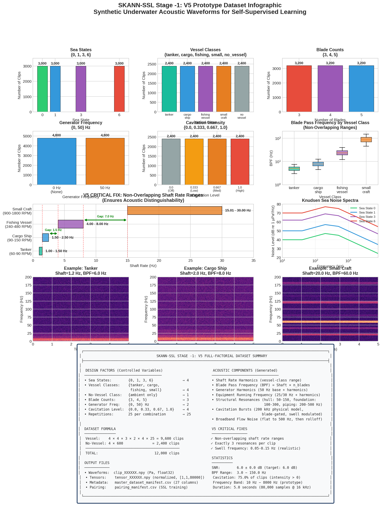

# Underwater Acoustic Synthetic Dataset

[]()
[]()
[](http://creativecommons.org/licenses/by/4.0/)
[](https://doi.org/10.57967/hf/11191)

A physics-based synthetic underwater acoustic dataset for machine learning research in vessel detection and classification. This dataset was developed as part of the SKANN-SSL (Selective-Kernel Acoustic Neural Network with Self-Supervised Learning) project.

Developed by [Sunil Tyagi](https://suniltyagi.in/) at [Oravont Systems LLP](https://oravontsystems.com/), Noida, India. The generation physics and verification calculations are documented in the [dataset note on suniltyagi.in](https://suniltyagi.in/notes/synthetic-dataset/).



---

## Overview

This dataset provides **12,000 synthetic underwater acoustic waveforms** combining:

1. **Sea Noise** — Piecewise parametric Knudsen model (4 sea states)
2. **Ship Noise** — Tonal + broadband + cavitation components (4 vessel classes)
3. **No-Vessel** — Ambient ocean noise only (detection capability)

The generator produces a **full-factorial structured dataset** covering all combinations of design factors for systematic ML training and evaluation.

---

## Dataset Specifications

| Parameter | Value |
|-----------|-------|
| **Total Clips** | 12,000 |
| **Vessel Clips** | 9,600 (4 classes × 2,400 each) |
| **No-Vessel Clips** | 2,400 |
| **Duration** | 5.0 seconds per clip |
| **Sample Rate** | 16,000 Hz |
| **Samples per Clip** | 80,000 |
| **Signal-to-Noise Ratio** | 6.0 dB |
| **Frequency Band** | 10 – 8,000 Hz |
| **Reference Pressure** | 1 µPa (underwater standard) |

---

## Class Distribution

| Class | Clips | Shaft Rate (Hz) | Description |
|-------|-------|-----------------|-------------|
| `tanker` | 2,400 | 1.00 – 1.50 | Large slow vessels (60–90 RPM) |
| `cargo_ship` | 2,400 | 1.50 – 2.50 | Medium vessels (90–150 RPM) |
| `fishing_vessel` | 2,400 | 4.00 – 8.00 | Working vessels (240–480 RPM) |
| `small_craft` | 2,400 | 15.0 – 30.0 | Fast small vessels (900–1800 RPM) |
| `no_vessel` | 2,400 | — | Ambient sea noise only |

**Key Feature:** Non-overlapping shaft rate ranges ensure acoustic distinguishability between vessel classes.

---

## Full-Factorial Design

The dataset systematically covers all combinations of:

| Factor | Levels | Count |
|--------|--------|-------|
| Sea State | 0, 1, 3, 6 | 4 |
| Vessel Class | tanker, cargo_ship, fishing_vessel, small_craft | 4 |
| Blade Count | 3, 4, 5 | 3 |
| Generator Frequency | 0 Hz (off), 50 Hz | 2 |
| Cavitation Intensity | 0.0, 0.333, 0.667, 1.0 | 4 |
| Repetitions | 25 per combination | 25 |

**Formula:** 4 × 4 × 3 × 2 × 4 × 25 = **9,600 vessel clips** + 2,400 no-vessel = **12,000 total**

---

## Acoustic Components

Each vessel clip contains physically-motivated acoustic signatures:

### Tonal Components
- **Shaft Rate Harmonics** — Fundamental rotation frequency + harmonics
- **Blade Pass Frequency (BPF)** — Dominant tonal: BPF = shaft_rate × n_blades
- **Generator Harmonics** — 50/60 Hz electrical system
- **Equipment Running Frequency** — Auxiliary machinery (25/30 Hz)
- **Structural Resonances** — Hull modes (50–500 Hz), exactly 3 per clip

### Broadband Components
- **Flow Noise** — Hydrodynamic turbulence with power-law rolloff
- **Cavitation Bursts** — Physical bubble collapse model at 200 kHz, blade-gated timing

### Ambient Noise
- **Knudsen Sea Noise** — Digitised curves for 4 sea states (calm to strong breeze)

---

## Dataset Access

### Primary Download: Hugging Face

**[📥 huggingface.co/datasets/suniltyagi/underwater-acoustic-synthetic-dataset](https://huggingface.co/datasets/suniltyagi/underwater-acoustic-synthetic-dataset)** · DOI [10.57967/hf/11191](https://doi.org/10.57967/hf/11191)

On Hugging Face the clips are stored in subfolders of 1,000 (`waveforms/00/` … `waveforms/11/`, likewise `tensors/`), because the Hub allows at most 10,000 files per folder; the manifest there gives the subfolder paths. `pairing_manifest.csv` is included there.

### Alternative: Google Drive

**[📥 Download SKANN-SSL V5 Dataset](https://drive.google.com/drive/folders/1E6vhPnkY8x8YzZ3a-k6PnL_G9gnq5gBo)**

### File Structure

```
SKANN_SSL_V5_Dataset/
├── waveforms/
│   ├── clip_000000.npy
│   ├── clip_000001.npy
│   └── ... (12,000 files)
├── tensors/
│   ├── tensor_000000.npy
│   ├── tensor_000001.npy
│   └── ... (12,000 files)
├── master_dataset_manifest.csv    # 27-column metadata
└── pairing_manifest.csv           # SSL training pairs
```

### File Formats

| Type | Format | Shape | Units |
|------|--------|-------|-------|
| Waveforms | `.npy` (Float32) | (80000,) | Pascals |
| Tensors | `.npy` (Float32) | (1, 1, 80000) | Normalised |
| Manifest | `.csv` | 12,000 × 27 | Metadata |

---

## Quick Start

### Loading Data

```python
import numpy as np
import pandas as pd

# Load manifest
manifest = pd.read_csv('master_dataset_manifest.csv')

# Load a waveform (raw, in Pascals)
waveform = np.load('waveforms/clip_000000.npy')
print(f"Shape: {waveform.shape}, Duration: {len(waveform)/16000:.1f}s")

# Load a tensor (normalised, ready for CNN)
tensor = np.load('tensors/tensor_000000.npy')
print(f"Shape: {tensor.shape}")  # (1, 1, 80000)
```

### PyTorch DataLoader

```python
import torch
from torch.utils.data import Dataset, DataLoader
from pathlib import Path

class UnderwaterAcousticDataset(Dataset):
    def __init__(self, data_dir, use_tensors=True):
        self.data_dir = Path(data_dir)
        self.manifest = pd.read_csv(self.data_dir / 'master_dataset_manifest.csv')
        self.use_tensors = use_tensors
        
    def __len__(self):
        return len(self.manifest)
    
    def __getitem__(self, idx):
        row = self.manifest.iloc[idx]
        
        if self.use_tensors:
            x = np.load(self.data_dir / row['tensor_path'])
            x = torch.from_numpy(x).squeeze(0)  # (1, 80000)
        else:
            x = np.load(self.data_dir / row['waveform_path'])
            x = torch.from_numpy(x).float().unsqueeze(0)  # (1, 80000)
        
        return x, {
            'vessel_class': row['vessel_class'],
            'shaft_rate': row['shaft_rate'],
            'bpf': row['blade_pass_freq'],
            'sea_state': row['sea_state'],
        }

# Usage
dataset = UnderwaterAcousticDataset('./SKANN_SSL_V5_Dataset')
loader = DataLoader(dataset, batch_size=32, shuffle=True)
```

---

## Manifest Schema

The `master_dataset_manifest.csv` contains 27 columns:

| Column | Type | Description |
|--------|------|-------------|
| `clip_id` | int | Unique identifier (0–11999) |
| `repeat_index` | int | Repetition within combination |
| `sea_state` | int | Sea state (0, 1, 3, 6) |
| `vessel_class` | str | Class label |
| `n_blades` | int | Propeller blade count |
| `generator_freq` | float | Generator frequency (Hz) |
| `cavitation_intensity` | float | Cavitation level (0.0–1.0) |
| `shaft_rate` | float | Shaft rotation frequency (Hz) |
| `blade_pass_freq` | float | BPF = shaft_rate × n_blades |
| `has_cavitation` | bool | Cavitation present |
| `cavitation_peak_freq` | float | Cavitation spectral peak (Hz) |
| `n_cavitation_bursts` | int | Burst count in clip |
| `equipment_base_freq` | float | Equipment frequency (Hz) |
| `resonance_freq_1` | float | First resonance (Hz) |
| `resonance_freq_2` | float | Second resonance (Hz) |
| `resonance_freq_3` | float | Third resonance (Hz) |
| `sea_rms_pa` | float | Sea noise RMS (Pascals) |
| `ship_rms_pa` | float | Ship noise RMS (Pascals) |
| `combined_rms_pa` | float | Combined RMS (Pascals) |
| `scale_factor` | float | Ship scaling factor |
| `sea_spl_db` | float | Sea SPL (dB re 1 µPa) |
| `ship_spl_db` | float | Ship SPL (dB re 1 µPa) |
| `combined_spl_db` | float | Combined SPL (dB re 1 µPa) |
| `snr_db` | float | Signal-to-noise ratio (dB) |
| `filename` | str | Waveform filename |
| `tensor_path` | str | Tensor relative path |
| `waveform_path` | str | Waveform relative path |

---

## Physics Background

### Sea Noise (Knudsen Model)

Ambient ocean noise follows the piecewise parametric Knudsen model:

```
NL(f) = a · log₁₀(f) + b   [dB re 1 µPa²/Hz]
```

| Sea State | Description | SPL (dB re 1 µPa) |
|-----------|-------------|-------------------|
| 0 | Calm | 77.6 |
| 1 | Light air | 86.8 |
| 3 | Gentle breeze | 97.2 |
| 6 | Strong breeze | 103.6 |

Levels are the mean sea-noise SPL of each sea state in `master_dataset_manifest.csv` (column `sea_spl_db`).

### Cavitation Model

Propeller cavitation is modeled as discrete bubble collapse events:

- **Generation Rate:** 200 kHz (captures µs-scale physics)
- **Collapse Time:** 50–200 µs (Rayleigh collapse)
- **Timing:** Blade-gated with swell modulation (0.05–0.15 Hz)
- **Output:** Decimated to 16 kHz with anti-aliasing

---

## Citation

If you use this dataset, please cite:

```bibtex
@dataset{underwater_acoustic_synthetic_2026,
  author       = {Tyagi, Sunil},
  title        = {Underwater Acoustic Synthetic Dataset: Physics-Based 
                  Vessel Noise Signatures for Self-Supervised Learning},
  year         = {2026},
  version      = {5.0.0},
  publisher    = {Hugging Face},
  doi          = {10.57967/hf/11191},
  url          = {https://huggingface.co/datasets/suniltyagi/underwater-acoustic-synthetic-dataset},
  note         = {Oravont Systems LLP. Source repository: https://github.com/suniltyagialtair/Underwater-Acoustic-Synthetic-Dataset}
}
```

---

## Related Projects and Pages

- **Dataset note** — [A Physics-Grounded Synthetic Underwater Acoustic Dataset](https://suniltyagi.in/notes/synthetic-dataset/) on suniltyagi.in: design, generation physics and verification
- **Oravont Systems LLP** — [Deep learning for underwater domain awareness](https://oravontsystems.com/deep-learning/#synthetic), where the dataset serves pretraining · [Open UDA tools and data](https://oravontsystems.com/tools/#synthetic-dataset)
- **SKANN-SSL** — Selective-Kernel Acoustic Neural Network with Self-Supervised Learning (private repository); the architecture is described in arXiv:2609.07399

---

## License

[![CC BY 4.0][cc-by-image]][cc-by]

This project is licensed under a [Creative Commons Attribution 4.0 International License](http://creativecommons.org/licenses/by/4.0/).

[cc-by]: http://creativecommons.org/licenses/by/4.0/
[cc-by-image]: https://i.creativecommons.org/l/by/4.0/88x31.png

---

## References

- Knudsen, V. O., et al. (1948). "Underwater Ambient Noise." *Journal of Marine Research*.
- Ross, D. (1976). "Mechanics of Underwater Noise." Pergamon Press.
- Urick, R. J. (1983). "Principles of Underwater Sound." McGraw-Hill.

---

## Contact

For questions or collaboration inquiries, please open an issue or contact:
- **Sunil Tyagi** — [suniltyagi.in](https://suniltyagi.in/)
- **Oravont Systems LLP** — [oravontsystems.com/contact](https://oravontsystems.com/contact/)
